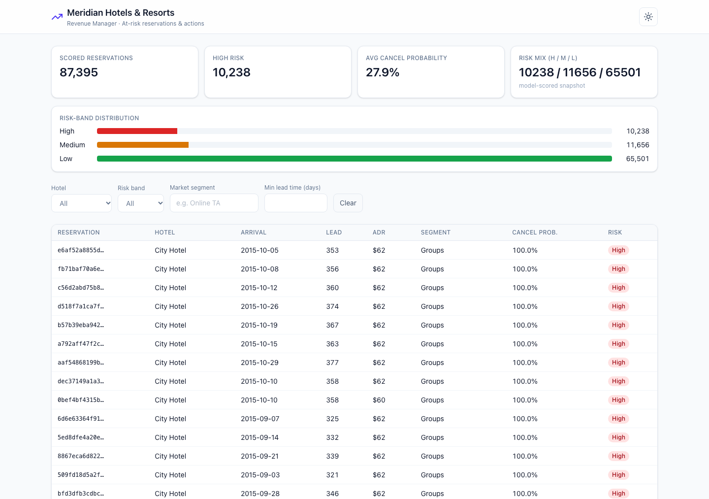
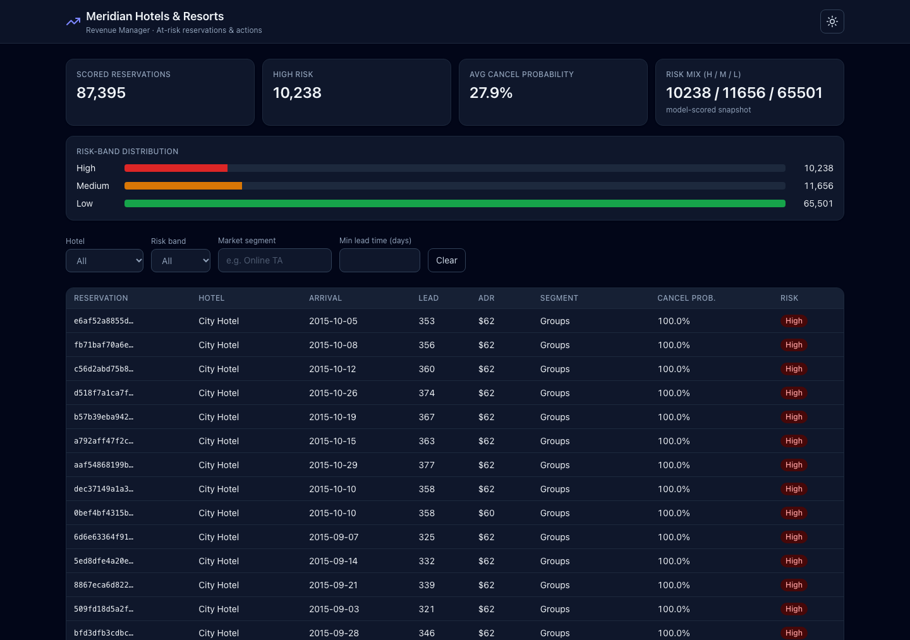
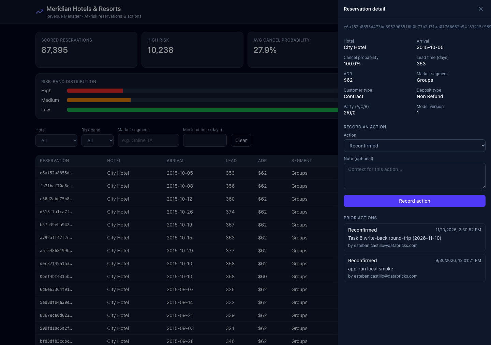

# Evidence — Hotel Revenue-Manager Databricks App (dev)

**Workspace:** fevm-fe-bar-ecastillo
**App:** hotel-revenue-app — https://hotel-revenue-app-7474655249991979.aws.databricksapps.com
**Service principal:** cef0d367-a051-4d3f-b82c-8beb5568d804 (`app-nx7ce0 hotel-revenue-app`)
**Data plane:** Lakebase instance hotel-lakebase, DB `hotel`
  (read `hotel_booking_dev.reservation_risk_serving_synced`, write `public.reservation_action`)
**Run date:** 2026-11-10

## UI (modern, responsive, light/dark)

Screenshots are the production React SPA against the same Lakebase instance
(local uvicorn with `DATABRICKS_PROFILE=fevm-fe-bar-ecastillo`). Chrome DevTools
MCP was unavailable in this session; KPI/table/write-back behavior was also
confirmed on the deployed app URL via authenticated `/api` calls (200s after
the SP grants).





## Write-back round-trip

Recorded an action via the deployed app API on reservation `e6af52a8855d473be89529055f6b0b77b2d71aa01766052b94f83215f989b5b4`:
- Submitted: action_type=`reconfirmed`, note=`Task 8 write-back round-trip (2026-11-10)` → 200, id=3.
- Re-fetched detail → the action appears under "Prior actions" (acted_by=`esteban.castillo@databricks.com`).
- The drawer screenshot shows the same row plus the earlier local-smoke action (id=2).
- Postgres confirmation:
  ```
   id |                          reservation_id                          | action_type |                   note                    |            acted_by             |           acted_at
  ----+------------------------------------------------------------------+-------------+-------------------------------------------+---------------------------------+-------------------------------
    3 | e6af52a8855d473be89529055f6b0b77b2d71aa01766052b94f83215f989b5b4 | reconfirmed | Task 8 write-back round-trip (2026-11-10) | esteban.castillo@databricks.com | 2026-11-10 20:30:52.064415+00
    2 | e6af52a8855d473be89529055f6b0b77b2d71aa01766052b94f83215f989b5b4 | reconfirmed | app-run local smoke                       | esteban.castillo@databricks.com | 2026-09-30 18:01:21.49225+00
  ```

## KPI parity (app vs direct SQL)

App `/api/kpis`: total=87395, high_risk=10238, avg_cancel_probability=0.2793
Direct psql: total=87395, high=10238, avg_prob=0.2793
Match: yes (counts exact; average matches at 4 d.p.)

## Deploy notes

- Declared as DABs `apps` resource (`resources/hotel_app.yml`); shipped by `databricks bundle deploy -t dev` (profile `fevm-fe-bar-ecastillo`).
- Connection uses the classic GA path (`w.database.generate_database_credential`,
  `read_write_dns`) with runtime-injected PG env (Approach A) + SDK fallback (Approach B).
- App SP Postgres grants: first applied via psql (Task 8 Step 4), then wired into
  `hotel_lakebase_sync` / `provision_writeback` so later environments get them from
  `databricks bundle run hotel_lakebase_sync`. Verified `grants_applied: true` for
  `cef0d367-a051-4d3f-b82c-8beb5568d804` on `hotel_booking_dev.reservation_risk_serving_synced`
  (SELECT) and `public.reservation_action` (SELECT/INSERT + sequence).
- After grants, deployed `/api/kpis` and `/api/reservations` returned 200 (earlier
  `permission denied for schema hotel_booking_dev` 500s stopped).
- Instance hotel-lakebase must be running; set `stopped: true` when idle.
